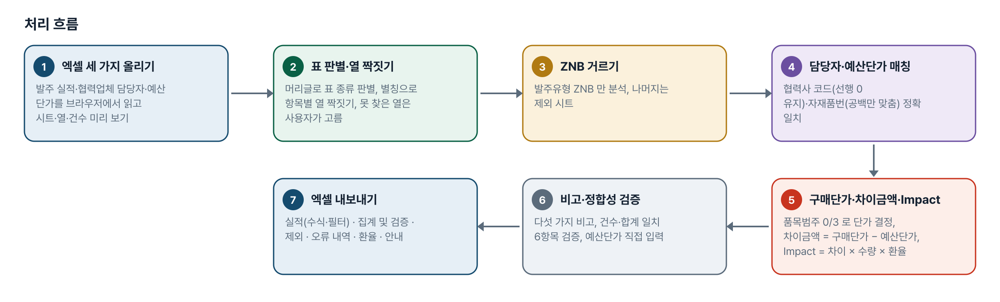
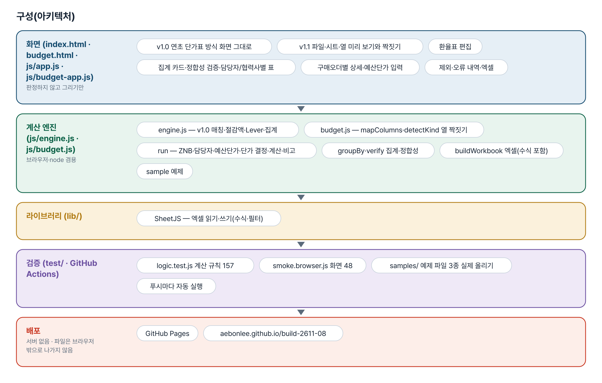
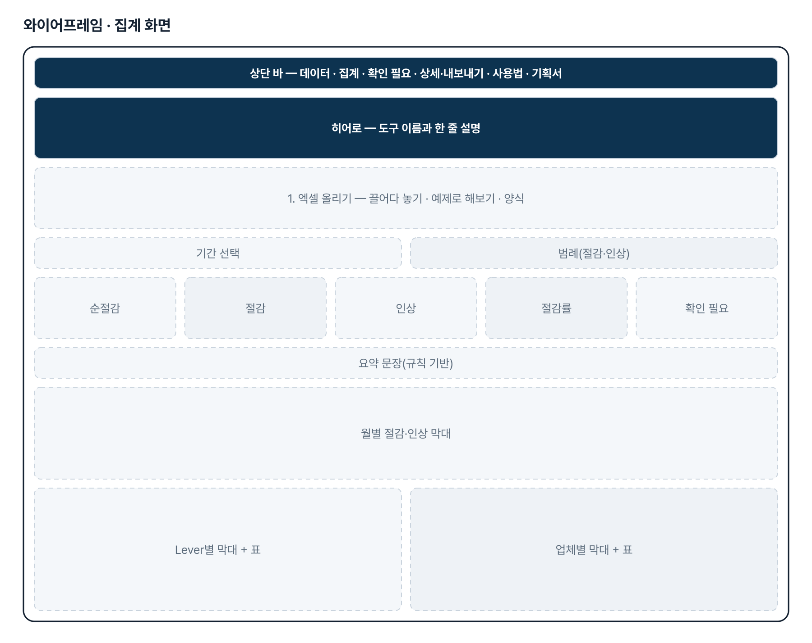
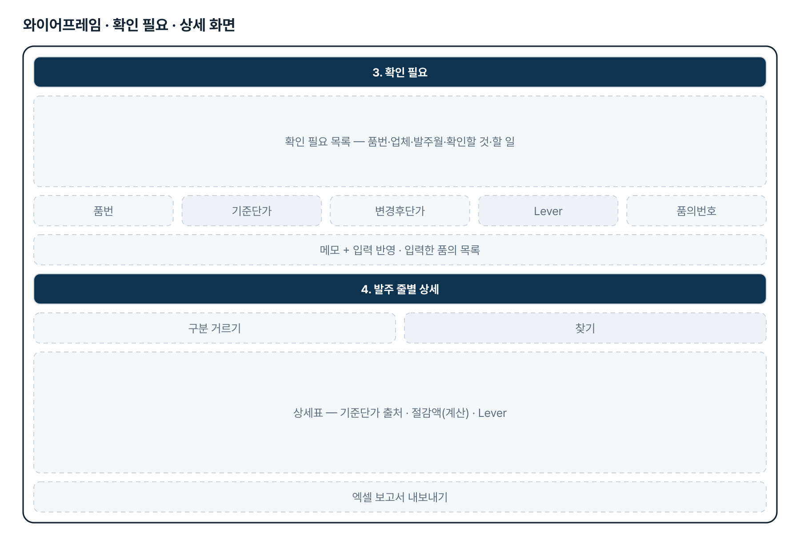
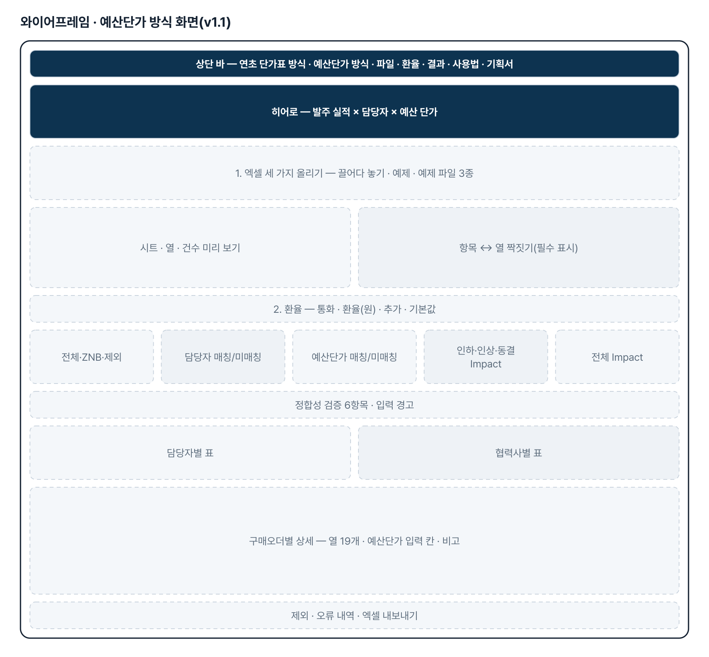
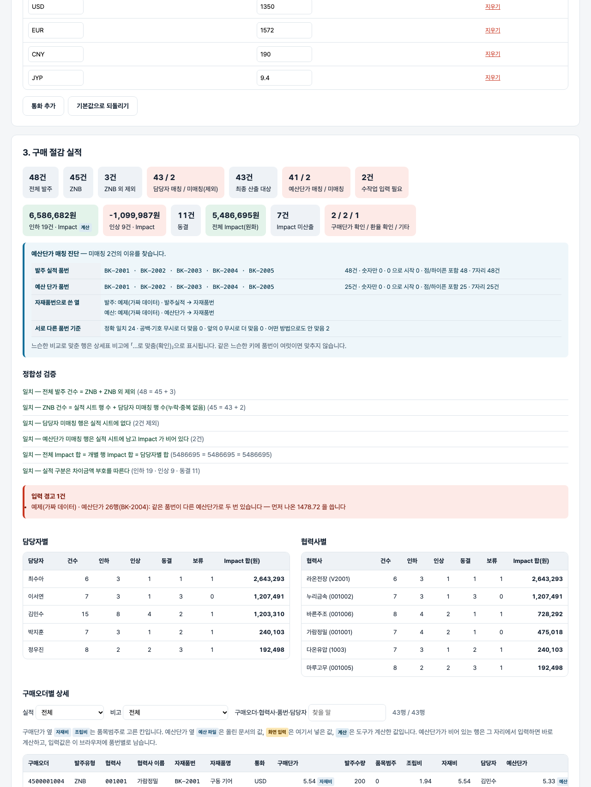

# 구매가 절감 실적 집계 — 프로젝트 기획서 v1.2

- 기획: 최상원 · 작성일 2026-11-04 · 생성형 AI 업무자동화 전문가과정 · 2차수 프로젝트 08
- 바로 쓰기: https://build-2611-08.jobability.co.kr/
- 워드 판: `docs/기획서/build-2611-08_최상원_구매가절감실적집계_기획서_v1.2.docx`

## 개요

월별 발주 실적과 연초 확정 단가표(엑셀)를 올리면 품번별 구매가 절감액을 계산하는 v1.0 흐름에 더해, v1.1 에서는 기획자의 상세 기획안대로 발주 실적·협력업체 담당자·예산 단가 세 파일을 매칭해 ZNB 발주의 차이금액·Impact·실적(인하/인상/동결)을 계산하고 보고용 엑셀(실적·집계 및 검증·제외·오류 내역)을 만드는 도구입니다.

### 배경 · 현재 업무
- 매월 구매가 절감 실적을 수작업으로 집계합니다.
- 기존 품번은 연초 확정 단가와 실 발주 단가를 맞대면 되지만, 신규 품번은 설계·업체 변경 품의서를 찾아 기준 단가와 사유를 확인해야 합니다.
- 신규 품번과 돌발 변수 집계가 병목입니다. 기준을 못 찾은 줄이 0으로 세어지면 실적이 줄어도 드러나지 않습니다.
- 변동 사유(Lever)별 실적이 정리돼야 구매 전략을 세울 수 있습니다.
- v1.1: 기획자가 상세 기획안을 다시 올렸습니다 — 실제 보고는 발주유형 ZNB 발주를 협력사 코드로 담당자와, 자재품번으로 예산단가·NOTE 와 맞추고, 품목범주로 구매단가를 정해 차이금액·Impact 를 내는 방식입니다.

### 목표
- 발주 실적과 확정 단가표를 그대로 올려 품번별 절감액을 즉시 계산합니다.
- 신규 품번은 품의서 정보 표나 화면 입력으로 매칭하고, 못 맞춘 품번은 확인 필요 목록으로 따로 보여 줍니다.
- Lever·업체·월별 절감과 인상을 나눠 집계하고 그래프로 보여 줍니다.
- 결과를 엑셀 보고서로 내보내 보고에 바로 씁니다.
- v1.1: 세 파일을 올리면 열 짝짓기·ZNB 거르기·담당자/예산단가 매칭·구매단가 결정·차이금액/Impact/실적 계산·비고까지 자동으로 하고, 열 순서가 고정된 보고용 엑셀을 냅니다.

## 요구사항과 구현

| 기획서 요구 | 구현 |
|---|---|
| 월별 발주 실적 수집·통합 | 엑셀 여러 개·시트 여러 장을 한 번에 올림. 머리글로 표 종류 판별, 열 이름 별칭 |
| 기존 품번 절감 산출 | (연초 확정 단가 − 실 발주 단가) × 발주 수량 |
| 신규 품번 절감 산출 | (품의서 기준 단가 − 실 발주 단가) × 발주 수량. 품의서 정보는 표로 올리거나 화면 입력 |
| 정확성·신뢰성 | 기준 단가 출처 표시(연초 단가표·품의서 표·화면 입력), 품의 변경후단가와 발주단가가 다르면 확인 필요 |
| Lever별 자동 분류 | 원자재 연동·가공비 현실화·VA/VE·BCC·국산화·기타 + 미분류, 표기 흔들림 맞춤 |
| 신규 품번·돌발 변수 병목 | 확인 필요 목록 3종, 기호만 다른 품번의 품의 제안·한 번에 연결 |
| 분석·보고 | Lever·업체·월·품번별 집계, 그래프, 엑셀 보고서 9시트, 요약 문장(AI 다듬기 선택) |
| (v1.1) 입력 3종 · 열 이름이 달라도 매칭 | 발주 실적·협력업체 담당자·예산 단가. 같은 뜻 낱말 표(ALIASES)로 짝짓고 못 찾은 열은 화면에서 고름. 파일마다 시트 구성·열·건수·첫 세 줄 미리 보기 |
| (v1.1) 발주유형 ZNB 만 분석 | ZNB 외는 「제외(비ZNB)」 시트에 보관. 공백·대소문자는 맞춤 |
| (v1.1) 협력업체 담당자 매칭 | 협력사 코드 정확 일치(앞뒤 공백·숫자/글자 형식만 맞춤, 선행 0 유지). 미매칭은 「미매칭」 표시 + 실적에서 제외 + 「오류 내역」 |
| (v1.1) 예산 단가 매칭·수작업 입력 | 자재품번 정확 일치(공백만 맞춤). 미매칭 행은 남기고 예산단가·차이금액·Impact·실적 공란 + 비고. 화면 입력 칸(브라우저에 품번별 보관, 재처리에도 유지), 엑셀은 예산단가를 넣으면 수식이 자동 계산 |
| (v1.1) 구매단가 결정 | 품목범주 0 → 자재비, 3 → 조립비. 그 밖·공란·숫자 아님 → 「구매단가 확인 필요」 |
| (v1.1) 차이금액·Impact·실적 | 차이금액 = 구매단가 − 예산단가(양수 인하 · 음수 인상 · 0 동결). Impact = 차이금액 × 발주수량 × 환율, 정수 반올림. 환율 KRW 1 · USD 1,350 · EUR 1,572 · CNY 190 · JYP 9.4(화면에서 수정), JPY 는 확인 대상, 정의 없는 통화 「환율 확인 필요」 |
| (v1.1) Lever·비고·출력 형식 | Lever = NOTE 그대로. 비고는 다섯 가지만, 정상은 공란. 「구매절감 실적」 시트 열 19개 순서 고정 · 구매오더 단위 유지 · 집계 및 검증 · 제외 · 오류 내역 · 환율 시트 |

## 주요 기능

- **데이터 올리기** — 발주실적·확정단가·품의서 표를 머리글로 알아보고 발주월·단가 표기를 맞춥니다. 틀린 줄은 버리지 않고 입력 경고로 알립니다.
- **절감액 계산** — 품번마다 기준 단가를 찾아 절감·인상·변동 없음을 가르고, 기준 단가 출처와 「계산」 표시를 붙입니다.
- **확인 필요 목록** — 기준 단가 없음·품의 단가 불일치·사유 없음을 품번별로 모읍니다. 기준이 없는 줄은 실적에서 뺍니다.
- **품의 정보 입력·연결** — 화면에서 기준단가·Lever·품의번호를 넣거나, 기호만 다른 품번의 품의를 버튼 하나로 연결합니다.
- **집계·그래프** — 월별 절감·인상 막대, Lever·업체별 양방향 막대와 표, 규칙 기반 요약 문장을 보여 줍니다.
- **엑셀 보고서** — 요약·월별·Lever별·업체별·품번별·발주상세·확인필요·품의서정보·입력경고 시트를 만듭니다.
- **(v1.1) 파일·열 짝짓기** — 시트마다 어느 표인지 자동 판별하고 항목별 열을 별칭으로 짝짓습니다. 못 찾은 필수 열은 빨간 표시와 함께 고르게 합니다.
- **(v1.1) 매칭·계산** — ZNB 거르기, 담당자·예산단가 매칭, 품목범주별 구매단가, 차이금액·Impact·실적, 비고를 한 번에 계산하고 정합성 6항목을 스스로 검증합니다.
- **(v1.1) 예산단가 직접 입력·환율 수정** — 미매칭 행에서 바로 입력하면 다시 계산하고 브라우저에 남습니다. 환율표도 화면에서 고칩니다.
- **(v1.1) 보고용 엑셀** — 열 순서 고정 실적 시트(예산단가 입력 시 수식 자동 계산·필터), 집계 및 검증, 제외, 오류 내역, 환율, 안내 시트를 만듭니다.

## 처리 흐름(파이프라인)

1. **엑셀 세 가지 올리기** — 발주 실적·협력업체 담당자·예산 단가를 브라우저에서 읽고 시트·열·건수 미리 보기
2. **표 판별·열 짝짓기** — 머리글로 표 종류 판별, 별칭으로 항목별 열 짝짓기, 못 찾은 열은 사용자가 고름
3. **ZNB 거르기** — 발주유형 ZNB 만 분석, 나머지는 제외 시트
4. **담당자·예산단가 매칭** — 협력사 코드(선행 0 유지)·자재품번(공백만 맞춤) 정확 일치
5. **구매단가·차이금액·Impact** — 품목범주 0/3 로 단가 결정, 차이금액 = 구매단가 − 예산단가, Impact = 차이 × 수량 × 환율
6. **비고·정합성 검증** — 다섯 가지 비고, 건수·합계 일치 6항목 검증, 예산단가 직접 입력
7. **엑셀 내보내기** — 실적(수식·필터) · 집계 및 검증 · 제외 · 오류 내역 · 환율 · 안내

## 구성(아키텍처)

- **화면 (index.html · budget.html · js/app.js · js/budget-app.js)** — v1.0 연초 단가표 방식 화면 그대로 · v1.1 파일·시트·열 미리 보기와 짝짓기 · 환율표 편집 · 집계 카드·정합성 검증·담당자/협력사별 표 · 구매오더별 상세·예산단가 입력 · 제외·오류 내역·엑셀
- **계산 엔진 (js/engine.js · js/budget.js)** — engine.js — v1.0 매칭·절감액·Lever·집계 · budget.js — mapColumns·detectKind 열 짝짓기 · run — ZNB·담당자·예산단가·단가 결정·계산·비고 · groupBy·verify 집계·정합성 · buildWorkbook 엑셀(수식 포함) · sample 예제
- **라이브러리 (lib/)** — SheetJS — 엑셀 읽기·쓰기(수식·필터)
- **검증 (test/ · GitHub Actions)** — logic.test.js 계산 규칙 157 · smoke.browser.js 화면 48 · samples/ 예제 파일 3종 실제 올리기 · 푸시마다 자동 실행
- **배포** — GitHub Pages · aebonlee.github.io/build-2611-08

## 화면 구성(와이어프레임)

## 규칙 · 판정 기준

- 기존 품번 = (연초 확정 단가 − 실 발주 단가) × 발주 수량. 신규 품번 = (품의서 기준 단가 − 실 발주 단가) × 발주 수량.
- 양수는 절감, 음수는 인상. 절감률 = 순절감 ÷ 기준 금액(기준 단가 × 수량의 합).
- 기준 단가를 못 찾은 줄은 0으로 세지 않고 실적에서 빼 확인 필요로 보냅니다.
- 품번은 대소문자·공백만 무시합니다. 하이픈은 무시하지 않고, 기호만 다른 품번은 제안만 합니다.
- 같은 품번 품의가 여럿이면 화면 입력이 표보다 우선합니다. 단가가 바뀌었는데 Lever 가 없으면 미분류로 집계합니다.
- (v1.1) 발주유형 ZNB 만 분석합니다. 협력사 코드는 공백·숫자/글자 형식만 맞추고 선행 0 은 지우지 않으며, 자재품번은 공백만 맞춥니다.
- (v1.1) 구매단가는 품목범주 0 → 자재비, 3 → 조립비. 차이금액 = 구매단가 − 예산단가(양수 인하 · 음수 인상 · 0 동결, 기획자 정의). Impact = 차이금액 × 발주수량 × 환율, 원화 정수 반올림. 필수값이 없으면 Impact 를 내지 않습니다.
- (v1.1) 담당자 미매칭 행은 실적 시트에서 빼고 오류 내역에, 예산단가 미매칭 행은 실적 시트에 남기고 예산단가·차이금액·Impact·실적을 비웁니다. 화면 입력 예산단가는 파일에 없을 때만 쓰고 재처리해도 지우지 않습니다.
- (v1.1) JYP 는 코드가 JYP 일 때만 9.4 를 적용하고 JPY 처럼 글자만 비슷한 코드는 바꾸지 않습니다. 비고는 담당자 미매칭 · 예산단가 미매칭 - 수작업 입력 필요 · 구매단가 확인 필요 · 환율 확인 필요 · 기타 데이터 오류 중에서만 적습니다.
- (v1.2) 자재품번 매칭 순서: 정확 일치 → 공백·점·하이픈·밑줄·슬래시·대소문자 무시 → 숫자만(앞의 0 무시, 4자리 이상). 느슨하게 맞춘 행은 비고에 표시하고, 같은 느슨한 키에 서로 다른 품번이 여럿이면 맞추지 않는다(엉뚱한 단가보다 미매칭이 낫다).

## 검증

- 계산 규칙 테스트 178개 · 화면 연기 테스트 48개 통과
- v1.0 계산 66개·화면 19개는 그대로 통과합니다. v1.1 에서 계산 91개·화면 29개를 더했습니다.
- v1.1 계산 테스트: 코드·품번 정규화(선행 0 유지), 열 짝짓기·표 판별, 단가 결정, 환율(JYP/JPY/미정의), 손으로 센 15행 사례(차이금액 부호·Impact 반올림·비고·Lever·집계·정합성), 화면 입력 예산단가 유지, 환율 변경, 엑셀 열 순서·수식·제외/포함·숫자 형식·다시 읽기, 예제 범위.
- 되돌려 확인: 선행 0 제거(22 실패) · 실적을 Impact 부호로(4) · 내림 반올림(7) · JPY 를 JYP 로(10) · 열 순서 바꿈(5) · 담당자 미매칭 포함(18) · 화면 입력이 파일을 덮음(2) · 수식 제거(1) · ZNB 거르기 제거(15) · 품번 하이픈 제거(5) · 범주 3 을 자재비로(15) · 환율 없이 Impact(2) — 열두 가지 모두 잡혔습니다.
- 화면 테스트: 예제 → 시트 3장·짝짓기 12항목 → 43행·정합성 6항목 → 비고 네 가지·오류 내역·제외 3행 → 예산단가 입력·재방문 유지 → 환율 변경·되돌리기 → 거르기 → 담당자 표 끄기 → 엑셀 → samples/ 세 파일 실제 올리기 → 360px → 첫 화면 바로 가기 → 사용법.
- v1.0: 매칭 안 된 줄을 「절감 0」으로 세게 되돌리면 7개 테스트가 실패합니다. 비슷한 품번을 한 글자 차이까지 넓히자 연번 품번이 전부 제안돼 기호·공백 차이만 남겼습니다.

## 이번 판에서 하지 않는 것

- 신규 품번의 품의서 자동 검색은 하지 않습니다 — 품의서 정보는 표로 올리거나 화면에서 입력합니다.
- 사내 구매 시스템 자동 연동은 하지 않습니다(내려받은 엑셀을 올림).
- 화면에서 입력한 품의 정보는 창을 닫으면 사라집니다 — 보고서 「품의서정보」 시트를 다음 달에 다시 올립니다.
- (v1.1) 엑셀의 첫 행 고정과 수작업 입력 칸 색 구분은 넣지 못했습니다 — 동봉한 무료 SheetJS 가 셀 서식·틀 고정을 쓰지 않습니다. 필터는 들어 있고, 비고 열로 거르면 입력할 행이 모입니다.
- (v1.1) 엑셀에서 예산단가를 직접 넣으면 상세 행은 수식으로 계산되지만 「집계 및 검증」 시트의 숫자는 만든 시점의 값입니다. 도구에서 입력하고 다시 내보내면 맞습니다.
- (v1.1) 같은 협력사 코드·자재품번이 담당자·예산 단가 표에 다른 값으로 두 번 있으면 먼저 나온 값을 쓰고 경고합니다(기획안대로 중복 자체는 오류로 보지 않습니다).

## 다음 단계

- 기획자 실제 양식(가린 견본)으로 열 별칭 보강·검증
- (v1.1 이후) 월별 파일 누적·전월 대비 Impact 추이
- (v1.1 이후) 담당자별 보고 문장(규칙 기반 + AI 다듬기 선택)
- v1.0 흐름: 연간 누계·목표 대비 달성률, 품의서 PDF 읽기 보조
- (v1.2 이후) 기획자 실제 파일의 품번 모양(진단 표 캡처)을 받아 어느 단계에서 맞는지 확인

## 버전 이력

- **v1.2** (2026-11-04) — 기획자 보고(패들릿 2026-11-04 오전 「품번으로 매칭해서 예산단가를 활용해야 하는데 매칭이 안 됩니다」, 실제 파일 15,773건 중 예산단가 매칭 0) 대응 / 자재품번 매칭을 세 단계로 — 정확 일치 → 공백·점·하이픈·대소문자 무시 → 숫자만(앞의 0 무시, 엑셀이 품번을 숫자로 읽은 경우). 느슨하게 맞춘 행은 비고에 「…로 맞춤(확인)」, 같은 느슨한 키에 품번이 여럿이면 맞추지 않음 / 「예산단가 매칭 진단」 — 양쪽 품번 예시 5개 · 모양(숫자만 · 0 으로 시작 · 점/하이픈 · 자릿수) · 자재품번으로 쓴 열 · 기준별로 맞는 건수 · 원인 힌트 / 테스트 판정 158→178 · 화면 48
- **v1.1** (2026-11-03) — 기획자 상세 기획안(게시물 4129353795) 반영 — 발주 실적 × 협력업체 담당자 × 예산 단가 흐름을 새 화면(budget.html)으로 추가, v1.0 연초 단가표 방식은 그대로 / 열 짝짓기·ZNB 거르기·담당자/예산단가 매칭·품목범주별 구매단가·차이금액/Impact/실적·비고 다섯 가지·정합성 검증 6항목 / 예산단가 화면 입력(브라우저 보관·재처리 유지)·환율표 수정, 엑셀은 열 19개 순서 고정 + 예산단가 입력 시 수식 자동 계산 + 집계·제외·오류 내역·환율 시트 / 예제 파일 3종(samples/) · 계산 테스트 66→157 · 화면 테스트 19→48
- **v1.0** (2026-11-02) — 첫 판 — 품번 매칭·절감액·Lever·확인 필요·집계 그래프·엑셀 보고서 / 기획서 워드 판·파이프라인·아키텍처·와이어프레임 추가
